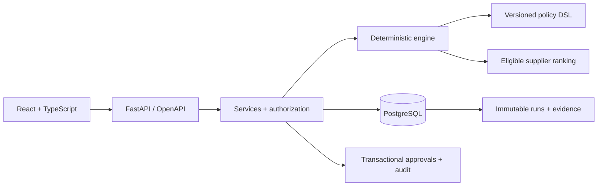

<div align="center">


**A policy-driven procurement platform with explainable decisions, governed amendments, and auditable purchasing.**

[Live application](https://corvo-procurement.vercel.app) · [Interactive API](https://corvo-procurement.vercel.app/docs) · [OpenAPI specification](openapi.json) · [Solution design](SOLUTION_DESIGN.md)


</div>

---

## Overview

Corvo converts conversational purchase requests and CSV batches into deterministic PO or sourcing recommendations. It resolves catalog items, groups compatible needs, evaluates contract headroom, applies versioned policies, ranks eligible suppliers, and preserves the evidence behind each decision.

A policy amendment changes configuration through the application’s review and activation workflow. Earlier runs remain reproducible from immutable snapshots. Procurement calculations live in the Python backend; the React interface displays actual server results and never recalculates financial decisions.

Built for the **Cantill.ai Full-stack Intern Challenge**. Verification badges record checks executed on **17 November 2026**; they are not continuous-monitoring or unseen-accuracy claims.

## Conversational assistance with a clear data boundary

The [isolated demo Request Studio](https://corvo-procurement-demo.vercel.app/request-studio) supports direct Gemini conversation, exact-source retrieval and read-only procurement tools. Enable the fictional-data acknowledgment before sending a demo message to Gemini. The live workspace uses local retrieval and deterministic intake; real procurement records and private assessment documents are never sent to an external model.

Google's `gemini-3.5-flash-lite` handles optional language planning and evidence explanation; `gemini-embedding-001` supplies optional 1536-dimensional embeddings for approved demo/public sources. PostgreSQL search, source access controls and purchasing decisions remain in FastAPI. Requests fall back transparently when the free service is unavailable or a response cannot be grounded. No AI Gateway, payment method, automatic paid fallback or local model is required.

The server key is named `GEMINI_API_KEY` and belongs only in the isolated demo project's Sensitive Vercel environment variables. It is never a `VITE_` variable. `.env.example` documents feature flags and resource bounds; [solution design](SOLUTION_DESIGN.md) explains source governance and transaction boundaries, and [verification evidence](VALIDATION.md) distinguishes actual hosted model calls from mocked tests.

## Explore the application

**[Open Corvo →](https://corvo-procurement.vercel.app)**

Choose **Individual account** and use the private evaluator credentials supplied separately. The evaluator account can inspect procurement and policy workflows; identity administration and bulk data replacement are restricted to the owner. No privileged live-workspace password is published. The same login page provides automatically filled built-in demo roles and personal fictional-demo signup. Individual users choose their workspace explicitly; new public accounts cannot access assessment master data.

| Workspace | What to inspect |
|---|---|
| **Overview** | Live counters, active policy and latest work queue |
| **Request Studio** | Multi-turn intake, clarification, corrections and confirmation before creating a PR |
| **Buyer Inbox / Decision X-Ray** | Source lines, grouping, exact valuation, contract rejections, rule traces and approval scope |
| **Batch Lab** | CSV processing, persisted runs, replay, same-input comparison and authenticated exports |
| **Policy Reactor** | Schema registry, policy DSL, amendment upload, preview, simulation and governed activation |
| **Supplier Constellation** | Dated rankings, score components, reference prices and preferred-supplier export |
| **Contract Vault** | Contract register, ceiling values and reviewed PDF proposals |
| **Purchase Orders / Sourcing / Audit Trail** | Persisted purchasing records, overrides and actor/time evidence |

For built-in access, select Controlled role account and choose Admin, Buyer or Requester: its public demo password appears automatically on this same page. Choose Admin for the complete fictional-data walkthrough. New users can select Individual account → New here? Create account; self-registration creates Requester accounts only. Public privileged demonstration passwords remain removed. Registration is an explicit environment setting, enabled on this hosted instance. [Health endpoint](https://corvo-procurement.vercel.app/health).

### Built-in accounts on the same login page

[Open Corvo](https://corvo-procurement.vercel.app). Choose Controlled role account, then Admin, Buyer or Requester; the public demonstration password fills automatically. Sign-in and all screens remain on the main website. A fixed same-origin `/demo-api/` gateway connects those accounts to the isolated demo backend. This deployment uses fictional DEMO-prefixed data, a restricted database role/schema and a separate session-signing key. It cannot access the live workspace's records. Its Admin can exercise procurement/policy workflows but cannot administer identities or replace data. The demo is shared; demonstration changes persist there.

Individual account passwords remain private and are never filled by the application. Switching to Individual account clears the built-in password; new users can create a Requester account. Switching accounts clears the in-memory token and query cache. A built-in role cannot access the live database.

### Isolated synthetic examples

In **Batch Lab → Try an isolated demo**, calculate nine fictional DEMO-prefixed requests using separate demo items, suppliers, history and contracts. Download the demo input, change quantities, upload it inside that section, and recalculate/export the result. The same backend procurement engine computes every outcome under a separate v5.0 policy.

Demo previews are labeled **synthetic / not saved**. They do not read or modify assessment masters, live policies, saved runs, dashboard totals, purchase orders or contract ceilings. Demo CSV experiments are limited to 200 rows. Use the ordinary Batch Lab upload for supplied assessment files and submission exports.

## Technology stack

| Layer | Technologies | Responsibility |
|---|---|---|
| **Frontend** | React 19 · TypeScript 5.9 · Vite 7 · Tailwind CSS 4 | Responsive workspaces and typed interaction |
| **Visual experience** | Three.js · React Three Fiber · GSAP · Motion | Original Arena dark interface, kinetic core and five-stage Decision X-Ray with a 2D evidence view |
| **Client data** | TanStack Query · Zod · React Router | Live queries, runtime response validation and role-aware navigation |
| **API** | FastAPI · Pydantic · Uvicorn | Typed endpoints, validation, authentication and OpenAPI |
| **Procurement engine** | Python · Decimal · RapidFuzz · validated policy DSL | Deterministic matching, valuation, routing and supplier selection |
| **Persistence** | PostgreSQL · SQLAlchemy · Alembic · psycopg | Durable records, migrations, transactional approvals and snapshots |
| **Documents** | pypdf | Contract and amendment text extraction with human review |
| **Conversational assistance** | Direct Gemini API · PostgreSQL full-text retrieval · optional Gemini embeddings | Demo-only external assistance; local retrieval and deterministic intake for live data |
| **Delivery** | Docker Compose · Vercel · Neon PostgreSQL | Reproducible local setup and persistent hosted application |
| **Verification** | pytest · Playwright · Node test runner · ESLint | Engine/API/concurrency regressions and real-backend browser workflows |

SQLite supports isolated tests and a Python-only local backend. Hosted production uses persistent PostgreSQL.

## Architecture



The pipeline validates input, resolves items, forms fixed-anchor requirements, evaluates contracts and exact values, applies first-match rules, selects suppliers, then consolidates compatible POs. Recommendation processing and simulation do not create purchasing commitments; buyer approval rechecks current headroom inside a transaction.

Read the [solution design](SOLUTION_DESIGN.md) for algorithms and invariants, and [DECISIONS.md](DECISIONS.md) for interpretations and rejected alternatives.

## Run locally

### Docker — recommended

Prerequisite: Docker Desktop with its Linux engine running.

```sh
docker compose up --build -d
```

Open **http://localhost:8000** for the application and **http://localhost:8000/docs** for the API. The build compiles the frontend, starts PostgreSQL with a named volume, runs migrations and launches FastAPI. Local roles are `requester`, `buyer` and `admin`, with password `corvo-demo`.

### Initialize the private assessment data

The repository deliberately excludes the original kit. Extract your supplied copy under `.private/Cantill_FullStack_Task_Kit/`, retaining its `master_data/`, `contracts/` and `pr_batches/` structure, then run:

```sh
docker compose exec api python -m scripts.import_kit /app/.private/Cantill_FullStack_Task_Kit
```

The private directory is mounted read-only for import. Register/PDF terms are reconciled and PDF-only contracts are included. Alternatively, an authenticated Admin can upload the original ZIP through `POST /api/admin/import-data`. Bulk replacement is blocked after purchasing commitments exist. The hosted application is already initialized.

<details>
<summary><strong>Run the backend and frontend without Docker</strong></summary>

Requires Python 3.11+ and Node/npm. Run from the repository root:

```sh
python -m venv .venv
# Windows: .venv\Scripts\activate
# macOS/Linux: source .venv/bin/activate
pip install -r requirements.txt
python -m alembic upgrade head
python -m scripts.import_kit .private/Cantill_FullStack_Task_Kit
npm ci --prefix frontend
npm run build --prefix frontend
python -m uvicorn backend.api:app --host 127.0.0.1 --port 8000
```

Without `DATABASE_URL`, the local backend uses ignored `.private/corvo.db`. For frontend development, run `npm run dev --prefix frontend` alongside FastAPI; its development proxy forwards API calls to port 8000.

</details>

<details>
<summary><strong>Environment configuration</strong></summary>

Copy `.env.example` to `.env` for local overrides. Never commit credentials.

| Variable | Purpose |
|---|---|
| `DATABASE_URL` | PostgreSQL connection; mandatory on Vercel |
| `SESSION_SECRET` | Stable, private token-signing key |
| `REQUESTER_PASSWORD`, `BUYER_PASSWORD`, `ADMIN_PASSWORD` | Private operational role passwords |
| `DEMO_MODE` | Enables local defaults; hosted production uses false |
| `SUBMISSION_ACCESS` | Local-only Requester demonstration alias; never exposes Admin/Buyer credentials |
| `PUBLIC_REGISTRATION` | Explicit opt-in to requester signup; false by default |
| `CORS_ORIGINS` | Exact permitted cross-origin frontend origins |
| `VITE_API_BASE_URL` | Empty for same-origin hosting; explicit backend origin for split development |

Private server credentials must never use a `VITE_` prefix. Production runs FastAPI and static assets on Vercel with persistent Neon PostgreSQL; durable state does not depend on the function filesystem. The hosted payload limit is 4.5 MB. Process large batches whole on an appropriate deployment rather than splitting grouping or ceiling allocation across separate uploads.

</details>

## API and exports

[Swagger UI](https://corvo-procurement.vercel.app/docs) and the checked-in [OpenAPI specification](openapi.json) are the authoritative endpoint references. Business APIs use bearer authentication, stable run IDs, paginated lists and structured errors. Monetary values are decimal strings.

```sh
curl -X POST http://localhost:8000/api/auth/login \
  -H 'Content-Type: application/json' \
  -d '{"role":"admin","password":"corvo-demo"}'

curl -X POST http://localhost:8000/api/process-batch \
  -H 'Authorization: Bearer YOUR_TOKEN' \
  -F 'file=@/private/path/batch.csv' -F 'policy_version=5.0'
```

Download decisions through `GET /api/runs/{id}/export.csv` with the bearer header. Exports preserve one row per input PR line, including explicit `NOT_PROCESSED` reasons.

```text
pr_no,pr_line,resolved_item_code,group_id,po_id,decision,route,supplier_id,unit_price,group_value_inr,suggested_supplier_ids,policy_version,reason
```

Preferred-supplier exports use `item_code,rank,supplier_id,reference_price` for the selected as-of date. Generated frontend TypeScript/Zod models are checked against `openapi.json` during release builds.

## Reproduce the two-policy evaluation

1. Process the supplied batch explicitly under **v5.0**, export decisions and retain its run/input hashes.
2. Upload the amendment in **Policy Reactor**. Inspect every clause, effective date, condition and priority; preview and simulate the draft.
3. Correct unsupported wording using the existing structured editor, then review, approve and activate. Approval alone does not activate a policy.
4. Process the **same original CSV** under the amended version. Export the second result and compare runs with identical input hashes.
5. Export preferred suppliers for the evaluator’s exact as-of date and selected policy version. Replay both decision snapshots.

Processing and export are sufficient for this comparison: approving a PO between runs would consume ceiling and change the purchasing baseline. After the assessment's **19 November 2026, 10:00 AM IST** source freeze, only the three actual result CSVs belong in `submission/`, pushed before **12:00 noon IST**. No fabricated submission files are included.

Validate export structure before submission:

```sh
python -m scripts.validate_submission --input .private/blind_batch.csv --run1 submission/run1.csv --run2 submission/run2.csv --preferred submission/preferred.csv --amended-version 6.0 --suppliers .private/Cantill_FullStack_Task_Kit/master_data/supplier_master.csv
```

Replace version, paths and filenames with the supplied values. This read-only tool checks headers, PR-line multiplicity, decimal/action consistency, repeated requirement/PO fields, preferred ranks and optional Active-supplier membership. It does not calculate decisions or certify policy interpretation.

## Verification

| Evidence | Result |
|---|---|
| Linux / PostgreSQL suite | **305 passed**, including independent concurrent transactions |
| Windows / SQLite suite | **301 passed**, with four PostgreSQL-only skips |
| Complete real-backend browser suite | **21 scenarios passed** against the retained Arena interface |
| Frontend quality gates | **7 unit tests passed**; lint, type checking and production build passed |
| Hosted Gemini and retrieval | Real cited response, confirmed stored request and eight persisted demo embeddings; repeat embedding produced no duplicates |
| Disclosed worked examples | **14 procurement decisions + 3 supplier rankings match** |
| Original sample | **186 outputs · 149 requirements · 2 explicit invalid lines** |
| Amendment rehearsal | Five policy changes, **55 affected lines**, three exports and matching replays |
| Hosted checks | Real API workflows, authenticated downloads, persistence after redeployment and startup recovery |

These results describe checks executed for the final readiness audit, not a predicted blind-test score. Fresh-browser production access, private evaluator permissions and authenticated CSV downloads were verified without changing deployment protection. A new browser rehearsal covered upload, structured amendment reconciliation, simulation, activation, unchanged-input reprocessing and all three exports without a purchasing approval. See the [blind-test readiness report](BLIND_TEST_READINESS.md) and [verification evidence](VALIDATION.md) for scope and limitations.

```sh
python -m pytest -q
npm run test:unit --prefix frontend
npm run lint --prefix frontend
npm run typecheck --prefix frontend
npm run build --prefix frontend
npm run test:e2e --prefix frontend
python -m scripts.generate_frontend_contract --check
# Hosted smoke: set CORVO_PASSWORD privately in your environment first
python -m scripts.smoke_deployment --base-url https://corvo-procurement.vercel.app --username evaluator --input /private/batch.csv
```

Browser tests start isolated FastAPI/SQLite with synthetic data. Install Chromium first from `frontend/` using `npx playwright install chromium`. The repository's Python virtual environment must exist; `CORVO_PYTHON` can select another interpreter. Original task data and private reports are excluded from public test fixtures.

## Evaluator documentation

| Document | Contents |
|---|---|
| [SOLUTION_DESIGN.md](SOLUTION_DESIGN.md) | Architecture, algorithms, policy lifecycle, evidence and concurrency |
| [DECISIONS.md](DECISIONS.md) | Business judgment, ambiguity handling, ranking formula and tradeoffs |
| [APPROACH.md](APPROACH.md) | Implementation strategy, technical choices and AI-tool disclosure |
| [REQUIREMENTS_TRACEABILITY.md](REQUIREMENTS_TRACEABILITY.md) | Requirement-to-code and verification mapping |
| [VALIDATION.md](VALIDATION.md) | Executed evidence, test environments and known limits |
| [BLIND_TEST_READINESS.md](BLIND_TEST_READINESS.md) | Final audit findings, independent rehearsals, access checks and freeze procedure |
| [Asset credits](frontend/ASSET_CREDITS.md) | Third-party visual attribution and source provenance |

## Boundaries

Live chat and amendment parsing use bounded deterministic grammars; the isolated demo additionally supports optional Gemini-assisted conversation. External calls require fictional-data acknowledgment and approved provenance. Known sensitive patterns are blocked, but this is not a guarantee that arbitrary user text can be classified perfectly. Unresolved amendment clauses require faithful structured authoring and review; new rules must use registered facts and supported operations. Scanned policies need transcription, and PDF extraction does not establish signature authenticity. Corporate SSO/MFA/recovery, external supplier dispatch and exhaustive load/security audits are outside the implemented scope. Approvals create durable internal purchasing records.

---

<div align="center">
<strong>Exact decisions. Visible evidence. Policies that can change.</strong><br />
<sub>Corvo Procurement OS · Cantill.ai assessment submission</sub>
</div>
