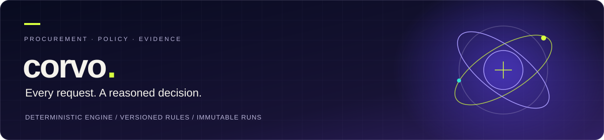
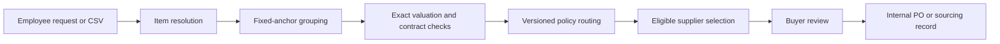

<div align="center">



# CORVO PROCUREMENT OS

A policy-driven procurement platform that converts purchase requests into explainable purchase-order and sourcing recommendations.

**[Live application](https://corvo-procurement.vercel.app) · [API documentation](https://corvo-procurement.vercel.app/docs) · [Architecture](SOLUTION_DESIGN.md) · [Engineering decisions](DECISIONS.md)**


</div>

## Access the right workspace

The same login page serves two isolated environments:

| Access | Select | Data and permissions |
|---|---|---|
| Fictional demonstration | **Controlled role account**, then Admin, Buyer or Requester | Its public demo password fills automatically. Admin provides the complete demonstration; Requester has a restricted workflow. |
| Private evaluation | **Individual account → Assessment** | Requires an owner-provisioned account. Assessment credentials are never published. The evaluator can use procurement and policy workflows but cannot administer identities or replace master data. |
| Personal fictional account | **Individual account → New here? Create account** | Creates a Requester in the fictional workspace with a password chosen by that user. It grants no assessment access. |

The header and banner identify the data mode. Demo and assessment tokens, databases and signing keys are separate. Demo changes persist only in the shared fictional workspace. The session token stays in memory; reloading requires sign-in. **Assessment credentials stay private. If reviewers need them, use an approved private channel; no separate credential-email requirement is claimed.**

## What Corvo does



Each saved run includes the source lines, item-match evidence, grouping anchors, price references, rejected contracts, evaluated rules and supplier scores. Replay uses that immutable snapshot. Processing and simulation produce recommendations; buyer approval separately rechecks current headroom and duplicate commitments.

| Capability | Where to inspect it |
|---|---|
| Conversational request intake, corrections and explicit PR confirmation | Request Studio |
| CSV validation, persisted runs, replay, same-input comparison and exact exports | Batch Lab |
| Matching, grouping, valuation, contract and rule evidence; readable fields with optional exact JSON | Decision X-Ray |
| Review, constrained sourcing overrides and explicit consolidated approval scope | Buyer Inbox |
| Amendments as policy data: upload, reconciliation, simulation, review, approval and activation | Policy Reactor |
| Dated supplier rankings, score components and reference-price exports | Supplier Constellation |
| Contract validity, remaining ceiling, source documents and reviewed proposals | Contract Vault |
| Operational counters and committed records with actor/time evidence | Overview, Purchase Orders, Sourcing and Audit Trail |

## Evaluator walkthrough

1. **Sign in.** Choose the built-in Admin for fictional exploration or the privately provisioned Individual assessment account for supplied data.
2. **Create a request or process a batch.** In Request Studio, inspect the assembled specification before confirming. For evaluation Run 1, upload the complete supplied CSV in Batch Lab and select **5.0** explicitly. Retain its run ID, input hash and export.
3. **Inspect the decision.** Use Decision X-Ray and Buyer Inbox to check matching, grouping, valuation, supplier eligibility and approval scope. Invalid input lines remain explicit `NOT_PROCESSED` outcomes.
4. **Upload and review the amendment.** In Policy Reactor, select the base version and enter a unique new version and effective date. Inspect every source clause. Unsupported wording stays unresolved until faithfully implemented through the registered DSL and mapped to saved executable changes.
5. **Simulate, review, approve and activate.** Save edits before simulation. Complete clause evidence and precedence acknowledgments, then perform the separate governance actions. Activating a policy does not approve a purchase order.
6. **Reprocess the original bytes.** For Run 2, select **Run 2: dated calendar through selected amendment** and the activated version. Earlier PR dates retain earlier effective policies. Compare the input hashes and replay both runs. Do not make purchasing approvals between Run 1 and Run 2.
7. **Export the results.** Download both exact decision CSVs. In Supplier Constellation, select the requested policy and as-of date, then download preferred suppliers. Validate all three files before submission.

For a quick fictional experiment, Batch Lab also has **Try an isolated demo**. This separate preview computes through the same engine without saving runs or changing dashboard totals, policies or ceilings. It accepts at most 200 lines; use ordinary Batch Lab for assessment processing.

## Architecture and technology

| Layer | Implementation |
|---|---|
| Interface | Arena-based React 19, TypeScript 5.9, Vite 7, Tailwind CSS 4; Three.js/R3F, GSAP and Motion retain the established industrial visuals |
| Client transport | TanStack Query, Zod and OpenAPI-generated TypeScript; monetary values remain decimal strings |
| Backend | FastAPI, Pydantic, Python `Decimal`, RapidFuzz and a validated first-match policy DSL |
| Persistence | PostgreSQL, SQLAlchemy, psycopg and Alembic; immutable run snapshots and transactional commitments |
| Documents and retrieval | pypdf extraction and local PostgreSQL retrieval; optional Gemini assistance is restricted to fictional/approved public content |
| Hosting | Vercel with persistent Neon PostgreSQL; Docker Compose for reproducible local operation |

The backend owns financial arithmetic, matching, grouping, routing, ranking and approvals. Optional demo conversation does not determine purchasing results. Live procurement records and private challenge documents stay local to the application. See [solution design](SOLUTION_DESIGN.md), [DECISIONS](DECISIONS.md) and the honest [AI-tool disclosure](APPROACH.md).

### Run locally

With Docker Desktop's Linux engine running:

```sh
docker compose up --build -d
```

Open **http://localhost:8000** and **http://localhost:8000/docs**. Docker builds the frontend, starts persistent PostgreSQL, runs migrations and launches FastAPI. Local controlled roles are `requester`, `buyer` and `admin`, with local-only password `corvo-demo`. Replace these defaults before any public hosting.

The private task kit is deliberately absent from Git and the image. Extract your supplied copy to `.private/Cantill_FullStack_Task_Kit/`, retaining `master_data/`, `contracts/` and `pr_batches/`, then import it through the read-only mount:

```sh
docker compose exec api python -m scripts.import_kit /app/.private/Cantill_FullStack_Task_Kit
```

The CLI reconciles register/PDF terms and includes PDF-only contracts. Bulk import is refused after purchasing commitments exist. The hosted assessment database is already initialized; its evaluator account cannot replace it.

<details>
<summary>Manual backend and frontend setup</summary>

Use Python 3.12+ and Node 24+. Run from the repository root:

```sh
python -m venv .venv
# Windows: .venv\Scripts\activate
# macOS/Linux: source .venv/bin/activate
pip install -r requirements.lock
python -m alembic upgrade head
python -m scripts.import_kit .private/Cantill_FullStack_Task_Kit
npm ci --prefix frontend
npm run build --prefix frontend
python -m uvicorn backend.api:app --host 127.0.0.1 --port 8000
```

Without `DATABASE_URL`, local Python uses ignored `.private/corvo.db`. For frontend development, run `npm run dev --prefix frontend` alongside FastAPI; the development proxy targets port 8000. Docker Compose reads `.env` for overrides. A standalone Python process reads shell environment variables; copying `.env.example` alone does not load those variables.

</details>

Configuration templates are [`.env.example`](.env.example) and [`frontend/.env.example`](frontend/.env.example). `DATABASE_URL` and a stable private `SESSION_SECRET` are required for hosted state. `CORS_ORIGINS` permits explicit cross-origin clients; `VITE_API_BASE_URL` is empty for same-origin hosting. Private credentials and `GEMINI_API_KEY` must never use a `VITE_` prefix. External AI is disabled in the assessment workspace. The application caps batch CSVs at **4,000,000 bytes**; neither that cap nor the 20,000-row parser bound guarantees hosted capacity. Never split a business batch across independent uploads: doing so changes grouping and ceiling allocation.

[`vercel.json`](vercel.json) is the active deployment configuration. [`render.yaml`](render.yaml) is retained only as an optional Docker-host blueprint for a separately supplied persistent database and private environment. No active Render deployment or verified Render-hosted run is claimed.

## API and exact exports

The [interactive API](https://corvo-procurement.vercel.app/docs) and checked-in [OpenAPI specification](openapi.json) define requests and responses. Business endpoints use bearer authentication, stable IDs, pagination and structured errors. Generated frontend schemas are checked for drift.

Decisions are downloaded from `GET /api/runs/{id}/export.csv`, using the bearer header:

```text
pr_no,pr_line,resolved_item_code,group_id,po_id,decision,route,supplier_id,unit_price,group_value_inr,suggested_supplier_ids,policy_version,reason
```

Preferred suppliers use `GET /api/preferred-suppliers/export.csv` with explicit `as_of` and policy parameters, and exactly `item_code,rank,supplier_id,reference_price`. API exports preserve one decision row per input line, including invalid outcomes.

## Verification

The final evaluator-polish verification produced the results below. [VALIDATION.md](VALIDATION.md) records environments, failure history, independent checks and hosted limits. Counts describe executed assertions, not an assessment score.

| Check | Verified result |
|---|---|
| Linux / PostgreSQL | **306 passed** |
| Windows / SQLite | **302 passed**, four PostgreSQL-only skips |
| Complete real-backend browser suite | **25 passed**, including all eleven desktop/mobile workspaces |
| Frontend unit tests | **7 passed** |
| ESLint, TypeScript, production build and API/client consistency | Passed |
| Privately checked worked examples | **14/14 decisions; 3/3 supplier rankings match** |
| Original sample | **186 outputs; 149 requirements; 2 invalid outcomes; unchanged business-output hash** |

Disclosed-example success does not establish unseen accuracy. The original sample hash is `9f4352ff8b07a32ce146194d44e336f4470de19c26fc2daba7a4000d55ebd94f`.

```sh
python -m pytest -q
npm run test:unit --prefix frontend
npm run lint --prefix frontend
npm run typecheck --prefix frontend
npm run build --prefix frontend
npm run test:e2e --prefix frontend
python -m scripts.generate_frontend_contract --check
python -m scripts.check_repository
```

Browser tests start isolated FastAPI/SQLite with synthetic masters. Install Chromium with `npx playwright install chromium` from `frontend/`. The Python virtual environment must exist; `CORVO_PYTHON` selects another interpreter. PostgreSQL-specific tests require an explicitly disposable database named `corvo_test`; never point tests at hosted assessment data.

## Freeze, submission and limits

**19 November 2026, 10:00 AM IST:** source-code freeze and application-link deadline. Afterward, do not change source, documentation, dependencies or tests. Apply the received amendment through the frozen application.

**19 November 2026, 12:00 noon IST:** output deadline. Push only the actual permitted CSVs to the existing `submission/` directory, using the recruiter-confirmed names:

```text
Soham_Gaonkhadkar__run1.csv
Soham_Gaonkhadkar__run2.csv
Soham_Gaonkhadkar__preferred.csv
```

Keep supplied inputs, private documents, credentials and evidence snapshots outside Git. No synthetic submission files are included. [BLIND_TEST_READINESS.md](BLIND_TEST_READINESS.md) gives the exact two-run procedure and read-only validation command. Official Forms submission must be confirmed separately. Do not claim credentials were delivered without confirmation.

Unsupported amendment wording needs faithful structured authoring and human review. Rules requiring unregistered facts or new engine operations cannot be promised without source changes. Scanned policies need transcription; PDF extraction does not verify signatures. Free services can cold-start or throttle, and large concurrent workloads remain unqualified. Corporate SSO/MFA/recovery, external supplier dispatch and exhaustive security certification are outside scope. These limitations do not change the deterministic authority of the implemented engine.

## Engineering documentation

| Document | Distinct evaluator purpose |
|---|---|
| [APPROACH.md](APPROACH.md) | Implementation strategy and Codex/Arena/optional Gemini disclosure |
| [DECISIONS.md](DECISIONS.md) | Policy ambiguities, financial/grouping/ranking choices and rejected alternatives |
| [SOLUTION_DESIGN.md](SOLUTION_DESIGN.md) | Modules, algorithms, persistence and governance architecture |
| [REQUIREMENTS_TRACEABILITY.md](REQUIREMENTS_TRACEABILITY.md) | Concise requirement-to-code and verification index |
| [VALIDATION.md](VALIDATION.md) | Executed tests, private original-data checks, synthetic rehearsals and production observations |
| [BLIND_TEST_READINESS.md](BLIND_TEST_READINESS.md) | Access, freeze and actual output-submission procedure |
| [Asset credits](frontend/ASSET_CREDITS.md) | Attribution for the photographs, footage and original visuals actually used |
