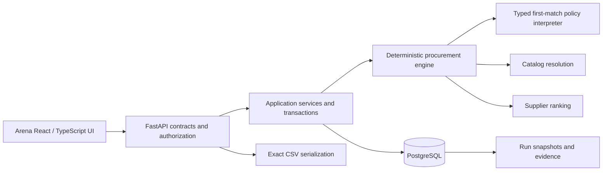
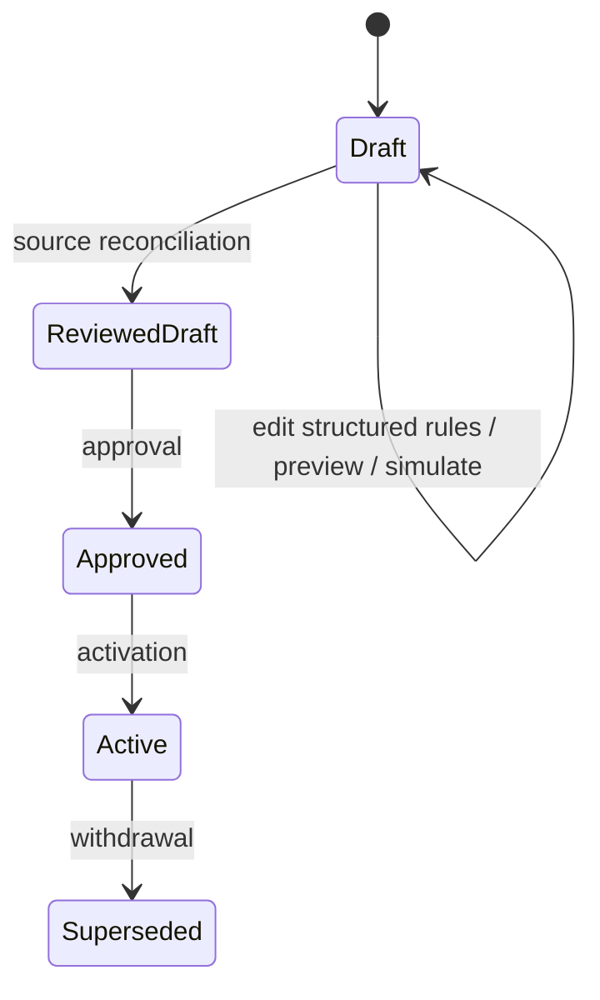

# Solution design

Corvo turns employee requests into explainable purchasing recommendations, then turns authorized approvals into durable purchasing records. Recommendations and commitments are deliberately separate: processing the same batch twice must not purchase twice or consume contract ceiling merely because somebody opened a preview.

This document describes implemented behavior. It does not claim an independent assessment score, unrestricted policy interpretation or external supplier fulfillment.

## 1. Architecture and responsibility boundaries



| Layer | Responsibility | Main implementation |
|---|---|---|
| Interface | Intake, review, evidence inspection, authenticated downloads | `frontend/src/pages/`, `frontend/src/api/` |
| Transport | Typed inputs, validation, authentication, pagination, error envelope | `backend/api.py`, `backend/schemas.py` |
| Application services | Snapshot creation, persistence, comparisons and audit events | `backend/service.py` |
| Business engine | Matching, grouping, valuation, contract allocation, routing, consolidation | `backend/engine.py`, `backend/matching.py`, `backend/suppliers.py` |
| Policy | Typed predicates, priorities, versioned parameters, bounded interpretation | `backend/policy.py`, `backend/language.py` |
| Persistence | Relational identities, source membership, commitments and JSON evidence | `backend/db.py`, `migrations/versions/` |

The engine takes explicit input rows, master data and policy snapshots. It does not perform HTTP calls or depend on browser state. The frontend displays server decisions and decimal strings; it does not implement a competing financial evaluator.

## 2. Processing sequence

```text
validate rows and preserve errors
resolve item identities without changing numeric specifications
sort by creation time, PR number and line
select effective policy and group against fixed first-line anchors
for each requirement in chronological order:
    evaluate contract applicability and remaining ceiling
    determine the exact valuation benchmark
    evaluate versioned rules in priority order
    select eligible suppliers and reference prices
    record evidence and batch-local allocations
consolidate compatible PO recommendations against fixed PO anchors
serialize one output row for every original PR line
persist input, data, policy and evidence snapshots
```

Sorting and explicit tie rules make the business result reproducible. Grouping scans existing groups; a simple worst-case bound is quadratic in PR-line count. This favors transparent policy fidelity over an unverified claim of high-volume throughput. The API bounds batches at 20,000 rows, but maximum-size latency on Vercel has not been load-tested. Hosting payload limits can be reached earlier.

## 3. Item resolution and incomplete input

A supplied catalog code takes precedence. Incorrect supplied codes require correction rather than an unrelated fuzzy substitution. Description-only matching normalizes industrial abbreviations while protecting dimensions, model numbers and other numeric specifications. Fuzzy acceptance requires both a confidence threshold and a margin over the next candidate. Ambiguous candidates remain visible for clarification.

For example, a request for a bearing with a different model suffix must not become an apparently similar catalog bearing simply because most words match. An unmatched item follows the new-item path, remains separate from other new items and requires a positive estimate. Invalid quantities, unknown plants, incompatible UoM and malformed rows produce explicit validation outcomes rather than invented values.

Duplicate or blank CSV headers are rejected before processing. This prevents a second `quantity` column from silently replacing the first during dictionary parsing.

## 4. Grouping is separate from PO consolidation

Requirement grouping applies anti-splitting controls before financial limits are evaluated. The anchor is the requirement's first PR line; later members do not extend its creation or need-by windows. If multiple requirements qualify, the earliest eligible one wins. Item, plant and selected policy version must agree. New items remain singletons.

Illustrative example: with a 14-day grouping window, lines on days 0 and 10 may group, but a day-20 line cannot join merely because it is close to the day-10 member. Moving the anchor would silently defeat the limit.

PO consolidation happens after routing. Distinct requirements can share a PO when supplier, plant and route agree and their timestamps fall within the configured window measured from the first requirement. Sourcing requests remain separate. These are two different business relationships, with separate IDs and evidence.

## 5. Valuation, contract selection and exact arithmetic

Contract evaluation records both **applicability** and **usability**. A contract can be valid for the date/item/supplier yet unusable because its remaining ceiling is insufficient. The cheapest usable contract determines contract ordering. If all applicable contracts are exhausted, their lowest applicable rate can still supply the valuation benchmark. Otherwise valuation falls back to the configured historical window, then the item standard price.

Requirement value and eventual direct-PO reference price are distinct facts. Routing can use a negotiated valuation benchmark while a preferred-supplier order uses that supplier's own reference price. Both sources are retained so a buyer can explain the difference.

All financial arithmetic uses bounded `Decimal` values with a 64-digit context. Routing uses exact values; CSV presentation rounds requirement values to two decimals using half-up rounding. Unit rates retain supplied precision. JavaScript never recomputes these decisions.

## 6. Supplier eligibility and explainable ranking

Eligibility is checked before ranking: only Active suppliers with qualifying item history or a started contract enter the preferred list. A historical relationship can remain relevant after a contract expires; a future contract cannot qualify early. Blocked and Inactive suppliers cannot receive orders or sourcing suggestions.

The baseline score weights normalized frequency, recency, contract history, delivery and quality at 25/25/20/15/15. Frequency is logarithmically scaled and capped to avoid overwhelming performance measures. Ties use supplier ID. Reference prices come from the supplier's latest qualifying item PO, otherwise its latest started item contract. Exact formulae and alternative choices appear in DECISIONS.md.

Sourcing starts with the preferred list, then adds eligible category suppliers by delivery/quality performance. If fewer suppliers exist than requested, Corvo returns the actual eligible set and explains the shortfall. It never invents suppliers to fill a requested count.

## 7. Policy amendments without application code changes



ReviewedDraft in the diagram means a draft with its governance review flag set; it is not a separate API status. Editing a draft clears its review state.

The interpreter accepts registered facts, typed comparisons and nested AND/OR/NOT conditions. Limits, windows, supplier counts, weights, priorities and routes are policy data. Unknown facts/operators are rejected. Uploaded content cannot execute Python or JavaScript.

The following is an illustrative rule fragment, not a complete upload document:

```json
{
  "id": "chakan-bearing-review",
  "priority": 15,
  "when": {
    "all": [
      {"fact": "requirement.plant", "op": "eq", "value": "CHK1"},
      {"fact": "item.category", "op": "eq", "value": "Bearings"},
      {"fact": "requirement.group_value_inr", "op": "gte", "value": "250000"}
    ]
  },
  "route": "RFQ",
  "reason": "Additional competition for the specified plant and category"
}
```

A complete policy also requires version, effective date, parameters and all intended rules. Priority is a business choice: this fragment runs before the baseline contract rule and must therefore be reviewed consciously. The schema registry exposes supported facts and operators.

The controlled-language compiler proposes changes from supported statements. Unresolved clauses stay visible and block ordinary review. A reviewer can author the correct DSL through the existing editor and acknowledge manual reconciliation. This is policy-data editing, not an application-code change. A condition requiring an entirely new underlying business fact or engine operation is outside this guarantee.

## 8. Recommendations, approvals and concurrency

Each run contains immutable input, master-data and policy snapshots, hashes and detailed evidence. Replay evaluates those snapshots rather than current data. New policies and later purchasing actions do not rewrite an earlier recommendation.

Approval operates on durable records in a transaction. It checks role, run scope, duplicate source commitments and current contract headroom. PostgreSQL row locks coordinate concurrent approvals; unique source commitments prevent the same PR line from purchasing twice across runs. A consolidated PO approval states the affected requirement scope. Simulations reserve no live ceiling.

An override retains the original recommendation and requires a written reason. The implemented override surface supports conservative sourcing routes instead of arbitrary direct orders that could bypass supplier and contract safeguards. Records are internal purchasing actions; no external PO transmission is claimed.

## 9. Evidence and operational boundaries

Decision evidence includes matching candidates, source lines, fixed anchors, exact valuation, contract rejection reasons, evaluated policy rules, supplier score components and selected price references. The buyer can inspect why the route was chosen, not just see its label.

Production uses Vercel/FastAPI with persistent Neon PostgreSQL. PDFs are processed in memory; original task files and credentials remain outside public source. Evaluator accounts are private and scoped; public privileged demonstration aliases are removed. Individual accounts retain requester isolation, password hashing, revocable sessions and throttling.

Known limitations include bounded language parsing, manual handling of scanned amendments, no signature authenticity verification, no corporate SSO/MFA/recovery, no external supplier dispatch and no exhaustive load/penetration testing. See VALIDATION.md for executed evidence and the limits of the assessment.

## Isolated demonstration data

The optional Batch Lab demo uses explicit fictional inputs from backend/demo.py and the unchanged procurement engine. Authenticated preview/export endpoints compute in memory against a fresh synthetic dataset and v5.0 policy; they never invoke run persistence, current master-data loading or purchase approval services. Nine input rows exercise all supported route families, grouping and invalid-line handling. Uploaded demo CSVs can alter the calculations, with a 200-row resource bound. Responses identify synthetic_preview and persistent=false; downloads are named synthetic-demo-*.csv. Ordinary assessment processing is unchanged.
